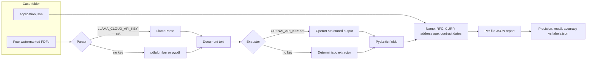

# Docval

[](https://github.com/Eflores1122/llm-document-validator-mx/actions/workflows/ci.yml)

Reference project for an LLM-assisted review of Mexican employee-onboarding files. It builds a fully synthetic expediente for a fictitious staffing company, Talento Bajío (printed on each page as Talento Bajio SA de CV): an identification summary, a constancia de situación fiscal, a comprobante de domicilio, and a contrato laboral or carta oferta. It parses those pages, extracts structured fields, and checks the questions a reviewer asks of a new hire: do the name, RFC, and CURP agree, is the address proof recent, and do the contract dates line up with the agreed start.

This repository is a reference implementation on synthetic data. Every person, client, and identifier below is fictional. RFC and CURP values only follow the public shape of those identifiers; they are not issued by SAT or RENAPO, and the identification summary is not an official credential (no photograph, barcode, or MRZ).

The default path needs no API keys. LlamaParse and OpenAI are optional backends.

## Problem

An onboarding file is four documents that must tell one story.

| Document | What the reviewer reads |
| --- | --- |
| Identification summary | Name, CURP, RFC, date of birth. A stand-in for an INE-style id, not an official card. |
| Constancia de situación fiscal | Name, RFC, CURP, fiscal postal code, issue date |
| Comprobante de domicilio | Holder, address, issue date |
| Contrato laboral or carta oferta | Name, RFC, CURP, start date, signature date |

The repetitive failures are cross-document, not inside a single page: a name that belongs to someone else, an RFC or CURP that drifted by a character, a utility bill older than the policy window, a contract start outside the allowed gap, or a contract filed without a signature date. Docval turns that checklist into a per-file report with a pass or fail and a reason for each rule.

## Architecture



`application.json` is the hire record (name, RFC, CURP, address, hire date, agreed start). `labels.json` is eval-only. `docval run` never reads it. Labels are produced by running the review rules on the fields that were printed. The score is whether parse and extraction recover those fields and whether the rules then make the same decision. Rule boundaries (the 7-day contract-start tie, the 90-day address tie, accents, initials, surname-first order) are also covered by unit tests that do not go through the generator.

## Quickstart

Requires Python 3.11+. No API keys.

```bash
python -m pip install -e ".[dev,api]"
python -m docval eval
```

That command scores the committed dataset in `data/golden` (24 cases, seed 42) and writes `reports/eval/report.md` and `reports/eval/report.json`.

Review one file:

```bash
python -m docval run data/golden/cases/EXP-0004
```

Regenerate the dataset, run the suite, or start the API:

```bash
python -m docval generate --out data/golden --cases 24 --seed 42 --force
make test
python -m uvicorn docval.api:app --host 127.0.0.1 --port 8000
```

`make test` is what CI runs: Ruff, then pytest, with vendor keys unset. Optional backends:

```bash
pip install -e ".[llm,api]"
# copy .env.example to .env and export OPENAI_API_KEY and/or LLAMA_CLOUD_API_KEY
python -m docval run data/golden/cases/EXP-0001 --parser llamaparse --extractor openai
```

With the keys unset, `--parser llamaparse` and `--extractor openai` exit with a clear error instead of silently calling a vendor. `mock` is an alias for the deterministic extractor.

### HTTP API

| Method | Path | Purpose |
| --- | --- | --- |
| `GET` | `/health` | Selected parser and extractor |
| `GET` | `/rules` | The five review rules |
| `POST` | `/validate` | Hire-record JSON plus document text |
| `POST` | `/cases/{case_id}/validate` | Replay one case under `DOCVAL_GOLDEN_ROOT` |

Case ids must look like `EXP-0001`. The handler resolves the folder and refuses paths outside the dataset root.

## Sample output

Fresh-process runs against the committed fixtures:

```text
$ python -m docval run data/golden/cases/EXP-0001 --out reports/examples
EXP-0001  PASS  1.6 ms
1 passed, 0 failed review, 0 errors. Reports in reports/examples.

$ python -m docval run data/golden/cases/EXP-0004 --out reports/examples
EXP-0004  FAIL  2.4 ms  name_consistency
0 passed, 1 failed review, 0 errors. Reports in reports/examples.

$ python -m docval run data/golden/cases/EXP-0008 --out reports/examples
EXP-0008  FAIL  2.4 ms  contract_dates
0 passed, 1 failed review, 0 errors. Reports in reports/examples.
```

`EXP-0004` is a name defect. The hire record, constancia, contract, and proof of address all say Diego Vargas Ortiz. The identification summary says Mariana Hernández Cruz. The full report is `reports/examples/EXP-0004.json`. The rule section is:

```json
[
  {
    "rule_id": "name_consistency",
    "passed": false,
    "reason": "Name mismatch against hire record 'Diego Vargas Ortiz': identificacion 'Mariana Hernández Cruz'."
  },
  {
    "rule_id": "rfc_consistency",
    "passed": true,
    "reason": "RFC agrees on VAOD740128HJK."
  },
  {
    "rule_id": "curp_consistency",
    "passed": true,
    "reason": "CURP agrees on VAOD740128HQTRRG64."
  },
  {
    "rule_id": "address_recency",
    "passed": true,
    "reason": "Proof of address issued 2026-08-12 is 50 days before the hire date (limit 90)."
  },
  {
    "rule_id": "contract_dates",
    "passed": true,
    "reason": "contract start 2026-10-01 vs agreed start 2026-10-01 (0 days <= limit 7); contract signed 2026-09-28 is on or before the start date 2026-10-01."
  }
]
```

`EXP-0008` fails only on the contract start. From `reports/examples/EXP-0008.json`:

> contract start 2026-10-31 vs agreed start 2026-10-01 (30 days > limit 7).

Files that should pass still exercise the matcher. `EXP-0001` prints the identification summary as `PÉREZ SILVA, ANA SOFÍA` while the hire record says `Ana Sofía Pérez Silva`. `EXP-0002` drops accents on the contract (`Ana Sofia Diaz Vazquez` vs `Ana Sofía Díaz Vázquez`) and the proof of address is exactly 90 days old (issued 2026-07-03). `EXP-0003` starts the contract on 2026-10-08, exactly 7 days after the agreed start, on the boundary of the window. All three pass. `EXP-0009` is a different failure: the contract is present but the signature date was never printed, so `contract_dates` fails closed.

## Evaluation

The positive class is a **fail**: a defect the reviewer should catch. Precision is the share of predicted failures that are real. Recall is the share of labeled failures the pipeline caught. Accuracy counts both correct passes and correct failures.

These tables are copied from [`reports/eval/report.md`](reports/eval/report.md), produced by `python -m docval eval` on `data/golden` (seed 42, 24 files, parser `local:pdfplumber`, extractor `deterministic`). There were no disagreements with the labels.

<!-- eval-table:start -->
| Rule | Fail | Pass | Precision | Recall | Accuracy |
| --- | ---: | ---: | ---: | ---: | ---: |
| name_consistency | 4 | 20 | 100.0% | 100.0% | 100.0% |
| rfc_consistency | 4 | 20 | 100.0% | 100.0% | 100.0% |
| curp_consistency | 2 | 22 | 100.0% | 100.0% | 100.0% |
| address_recency | 6 | 18 | 100.0% | 100.0% | 100.0% |
| contract_dates | 6 | 18 | 100.0% | 100.0% | 100.0% |
| overall | 18 | 6 | 100.0% | 100.0% | 100.0% |
<!-- eval-table:end -->

Field scores compare extracted values with the printed ground truth (672 slots). Names match under the same policy as the name rule. RFC and CURP are compared after punctuation is removed. Dates and the remaining strings are compared exactly.

<!-- field-table:start -->
| Document | Slots | Exact match | Precision | Recall |
| --- | ---: | ---: | ---: | ---: |
| identificacion | 144 | 100.0% | 100.0% | 100.0% |
| constancia_fiscal | 144 | 100.0% | 100.0% | 100.0% |
| comprobante_domicilio | 192 | 100.0% | 100.0% | 100.0% |
| contrato | 192 | 100.0% | 100.0% | 100.0% |
| all fields | 672 | 100.0% | 100.0% | 100.0% |
<!-- field-table:end -->

<!-- eval-timing:start -->
Mean 0.4 ms per file (p50 0.3 ms, p95 1.0 ms) over 24 files.
<!-- eval-timing:end -->

The committed JSON (`reports/eval/report.json`) records mean 0.405 ms, p50 0.337 ms, p95 1.002 ms, max 1.626 ms, and 9.726 ms for all 24 files in one process. The max is the first file, which pays for pdfplumber opening its first document. A one-file CLI run in a fresh process is about 2 ms of pipeline time, which is what the sample commands above show.

That latency is machine time on small digital PDFs with a deterministic extractor. Classification metrics are deterministic; latency will move with the machine.

A perfect score here means the deterministic extractor recovers both synthetic layouts, including hyphenated RFC/CURP strings, and the rules agree with the labels on every injected defect and every near miss. The same harness is what you would point at the OpenAI extractor for messier documents.

## Design decisions

- **Two layouts, one schema.** Each document type is rendered in two label variants (for example `Fecha de inicio` and `Fecha de ingreso`, `Contrato laboral` and `Carta oferta`, `Nombre` and `Contribuyente`). The deterministic extractor accepts both. Unseen layouts are the job of the OpenAI extractor, which asks `chat.completions.parse` for the same Pydantic model.
- **Keys select the backend.** `LLAMA_CLOUD_API_KEY` selects LlamaParse (`POST /api/v2/parse/upload`, then poll `expand=text_full`). `OPENAI_API_KEY` selects structured extraction. Empty values count as unset. The LlamaParse client uses the standard library, so the optional parser does not add a required dependency.
- **Fail closed.** A missing name, RFC, CURP, issue date, contract start, or signature date fails the rule that needs it. The report says which field was missing. A document that never arrives does the same: the rules that needed its fields fail, and the report adds a warning that lists the missing documents.
- **Name policy.** Comparison ignores accents, case, punctuation, and the particles de/del/la/los/y. Surname-first order matches. A single initial may match the word it starts. An extra surname on only one side does not match. Token typos must be very close (ratio at least 0.92, and only for tokens of length 5 or more).
- **Contract dates.** The contract start must fall within `DOCVAL_CONTRACT_MAX_GAP_DAYS` of the agreed start (default 7 days). A gap equal to the limit passes; 8 days fails; the dataset's 30-day miss fails. The signature date must be present and on or before the start date. A contract with no signature date fails.
- **Address age.** The proof must be dated on or before the hire date and no more than 90 days earlier (`DOCVAL_ADDRESS_MAX_AGE_DAYS`). The dataset's hire date is 2026-10-01 for every case, so the window does not change when the calendar does. A bill dated in the future fails.
- **Synthetic identifiers.** Homoclaves and the CURP check character are deterministic stand-ins, not the official algorithms. Voter keys start with `SYN`. Every page carries `DOCUMENTO FICTICIO - SIN VALIDEZ OFICIAL`. A document that arrives without that banner is still reviewed, and the report adds a warning.
- **Labels stay out of the decision.** `application.json` is the only case metadata the pipeline reads. Defects live in `labels.json`.

## Layout

```text
src/docval/           library and CLI
  generate.py         seeded synthetic expedientes
  parsers.py          local PDF parser and LlamaParse client
  extractors.py       deterministic extractor and OpenAI extractor
  rules.py            the five review rules
  pipeline.py         parse, extract, review
  evaluate.py         precision, recall, accuracy, latency
  cli.py              docval generate | run | eval | serve
  api.py              FastAPI
data/golden/          24 committed cases, seed 42
reports/eval/         eval report from the run quoted above
reports/examples/     EXP-0001, EXP-0004, EXP-0008
tests/                pytest, including the no-key path
```

## Development

```bash
make test          # ruff + pytest, no API keys
make eval          # rewrite reports/eval from data/golden
make generate      # rebuild data/golden with seed 42
docker build -t docval:local .
docker run --rm docval:local
```

CI is `.github/workflows/ci.yml`. It installs the `dev` extra on Python 3.11 and 3.12, runs Ruff (`ruff check` and `ruff format --check`), and runs pytest with `OPENAI_API_KEY` and `LLAMA_CLOUD_API_KEY` set to empty strings. A test reruns the eval and checks that classification metrics still match `reports/eval/report.json`, and that this README still quotes that report.

Configuration lives in `.env.example`. Thresholds are `DOCVAL_CONTRACT_MAX_GAP_DAYS` (default `7`) and `DOCVAL_ADDRESS_MAX_AGE_DAYS` (default `90`).

## License

MIT. Copyright (c) 2026 Edgar Flores. See [LICENSE](LICENSE).
